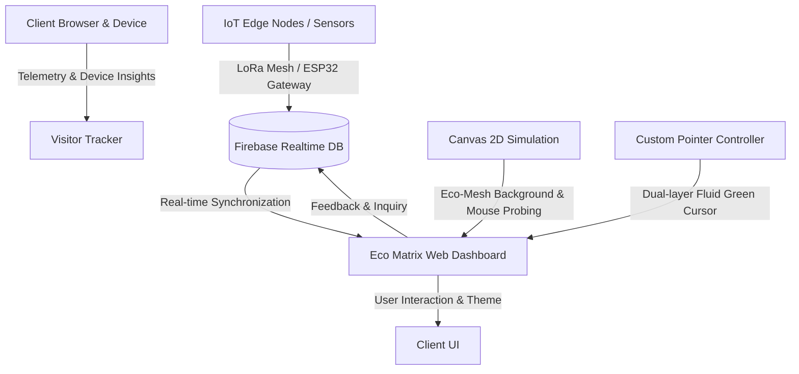

# 🌿 Eco Matrix

> **The autonomous lifeline for urban plants.**  
> A self-regulating, soil-sensing IoT mesh network and live dashboard designed to monitor, protect, and sustain urban trees and green spaces against heat, drought, and neglect.

---

## 📌 Table of Contents

- [Overview](#-overview)
- [Key Features](#-key-features)
- [System Architecture](#-system-architecture)
- [Tech Stack](#-tech-stack)
- [Interactive Visual Experience](#-interactive-visual-experience)
  - [Custom Green-Themed Cursor](#custom-green-themed-cursor)
  - [Themed Interactive Live Background (Eco-Mesh)](#themed-interactive-live-background-eco-mesh)
- [Repository Structure](#-repository-structure)
- [Getting Started](#-getting-started)
- [Configuration & Firebase Setup](#-configuration--firebase-setup)
- [Telemetry & Analytics](#-telemetry--analytics)
- [Hardware & Field Deployment](#-hardware--field-deployment)
- [Contributing](#-contributing)
- [License](#-license)

---

## 📖 Overview

Rapid urbanization and climate extremes subject city trees to severe environmental stress: compacted soil, irregular watering, heat islands, and neglect. In fact, up to 62% of young street trees perish within their first five years due to preventable water stress.

**Eco Matrix** addresses this crisis through:
1. **In-situ Soil & Microclimate Sensing:** Real-time data collection of soil moisture, ambient temperature, humidity, and sunlight.
2. **Autonomous Edge Mesh Nodes:** Solar-powered LoRa mesh nodes operating off-grid with intelligent power management.
3. **Live Web Control Center:** Responsive telemetry dashboard with real-time Firebase syncing, health scoring, and active alert systems.
4. **Community & Municipal Action:** Accessible data streams for urban arborists, municipal authorities, and community stewards.

---

## 🚀 Key Features

- **Real-Time Telemetry Dashboard:** Live monitoring of soil moisture, ambient temperature, overall network health index, water savings, and anomaly alerts.
- **Bi-directional Firebase Realtime Database Integration:** Dynamic live metric streaming, node state synchronization, and transaction activity logging.
- **Node Activity & Sensor Stream:** View individual sensor nodes with battery levels, readings, locations, and health statuses (`Healthy`, `Stress`, `Critical`).
- **Custom Green-Themed Cursor:** Dual-layer organic cursor with a glowing emerald precision dot, a smooth interpolating follower ring (`lerp`), interactive hover expansions, text-input I-beam morphing, and click ripple pulses.
- **Themed Interactive Live Background ("Eco-Mesh"):** Real-time HTML5 Canvas simulation rendering interconnected sensor nodes and swaying bio-spores with dynamic proximity lines, mouse sensor probing, and radial click shockwaves.
- **Adaptive Dark / Light Themes:** Cohesive theme adaptivity across the UI, custom cursor, and background particle palettes with persistent user preferences saved in `localStorage`.
- **Integrated Visitor Intelligence:** Built-in client and browser device detection (`detector.js`) and universal visitor telemetry logging (`tracker.js`).
- **Inquiry & Feedback Dispatch:** Interactive contact workflow logging inquiries directly to Firebase with timestamped identifiers.
- **Off-Grid & Resilient:** Tailored for decentralized LoRa peer-to-peer transmission, self-healing routing, and low-power hardware.

---

## 🏗️ System Architecture



---

## 💻 Tech Stack

### Frontend & Interface
- **HTML5:** Semantic architecture, accessible forms, SVG live specimen visualizer, and hardware-accelerated canvas element.
- **CSS3:** Custom properties (CSS variables), responsive flexbox and fluid grids, frosted-glass backdrops (`backdrop-filter`), keyframe animations, and fine-pointer media queries (`@media (hover: hover) and (pointer: fine)`).
- **Vanilla JavaScript (ES6+):** Pure client logic, modular IIFE architecture, event delegation, Canvas 2D simulation loop, `requestAnimationFrame` interpolation physics, and Firebase Realtime Database listeners.
- **Typography & Icons:** Google Fonts (*Fraunces*, *Inter*, *Space Mono*) and Font Awesome 6.5.

### Cloud & Backend
- **Firebase Realtime Database:** High-speed real-time database managing node telemetry (`ecomatrix/data`), node mapping (`ecomatrix/nodes`), and event logs (`ecomatrix/transactions`).

---

## ✨ Interactive Visual Experience

### Custom Green-Themed Cursor

The application features a bespoke, nature-inspired cursor engineered for smooth tactile feedback:
- **Inner Precision Dot (`.eco-cursor-dot`)**: 8px radiant emerald point (`#4ade80`) with a soft bioluminescent glow for instant, zero-latency feedback.
- **Outer Fluid Follower Ring (`.eco-cursor-ring`)**: 36px translucent organic ring with subtle backdrop blur, smoothly interpolating behind the cursor using linear interpolation (`lerp`) at 60/120 FPS.
- **Interactive Hover States**:
  - **Links & Buttons (`a`, `button`, `.btn-primary`, `.theme-toggle`, `.tab-btn`)**: Expands to 52px with an intensified green aura and subtle inner glow.
  - **Text Fields (`input[type="text"]`, `input[type="email"]`, `textarea`)**: The follower ring dissolves and the inner dot morphs into a clean 22px green vertical I-beam cursor for precise text selection.
- **Click Ripple Wave (`.eco-cursor-ripple`)**: Clicking anywhere triggers an expanding bio-pulse ripple that radiates outward and fades smoothly.
- **Device & Accessibility Protection**: Active only on fine-pointer devices with hover capability; touchscreens retain standard native touch interaction. Automatically respects `prefers-reduced-motion`.

### Themed Interactive Live Background (Eco-Mesh)

The entire viewport is backed by a responsive, GPU-friendly HTML5 Canvas simulation (`#ecoBgCanvas`):
- **Eco-Mesh & Sensor Nodes**: Drifting particles represent autonomous soil-sensing nodes and organic swaying spores. When nodes are within 130px, delicate connecting lines form, simulating an active LoRa mesh network.
- **Mouse Sensor Probing**: The cursor acts as an active environmental probe—nodes within 160px draw radiant dynamic connections to the cursor and gently deflect when close.
- **Click Bio-Shockwaves**: Mouse clicks trigger an expanding radial wave on the canvas that propagates across the mesh and gently influences nearby nodes.
- **Theme-Aware Color Palettes**:
  - **Dark Mode**: Bioluminescent seafoam (`#4ade80`), sage bright (`#a9c799`), warm clay (`#c98a5e`), and emerald (`#34d399`).
  - **Light Mode**: Deep forest green (`#166534`), sage moss (`#4a7344`), and clay (`#b86a3d`) with soft wireframe lines preserving text contrast.
- **Battery & CPU Optimization**: Automatically pauses simulation execution when the browser tab is hidden (`visibilitychange`), scales particle density dynamically to viewport width, and debounces window resizing.

---

## 📂 Repository Structure

```text
Eco-Matrix/
├── index.html          # Main application page, hero section, abstract, dashboard, background canvas & cursor elements
├── style.css           # Design tokens, color palette, responsive breakpoints, custom cursor & canvas styling
├── script.js           # Core UI logic, Firebase listeners, Eco-Mesh live background simulation & custom cursor controller
├── detector.js         # Comprehensive client, device, browser, and OS detection engine
├── tracker.js          # Universal visitor analytics, geo-location fallbacks, telemetry logger
├── credentials.js      # Configuration and credentials reference
├── favicon.png         # Site favicon
├── icon.png            # Application logo / asset
├── README.md           # Project documentation and developer guide
└── AGENTS.md           # Instructions, conventions, and rules for AI agents and contributors
```

---

## ⚡ Getting Started

### Prerequisites

All you need is a modern web browser and any static file server or local development server.

### Running Locally

1. **Clone the repository:**
   ```bash
   git clone https://github.com/Pavan-M-S/Eco-Matrix.git
   cd Eco-Matrix
   ```

2. **Serve the project:**
   You can serve the directory using any HTTP server:

   - **Using Python 3:**
     ```bash
     python3 -m http.server 8000
     ```
   - **Using Node `npx serve`:**
     ```bash
     npx serve .
     ```
   - **Using VS Code Live Server extension:**
     Right-click `index.html` and select **"Open with Live Server"**.

3. **Open the browser:**
   Navigate to `http://localhost:8000` (or the port specified by your server).

---

## ⚙️ Configuration & Firebase Setup

Firebase configuration is initialized inside `script.js`:

```javascript
const firebaseConfig = {
    apiKey: "YOUR_API_KEY",
    authDomain: "YOUR_AUTH_DOMAIN",
    databaseURL: "YOUR_DATABASE_URL",
    projectId: "YOUR_PROJECT_ID",
    storageBucket: "YOUR_STORAGE_BUCKET",
    messagingSenderId: "YOUR_SENDER_ID",
    appId: "YOUR_APP_ID"
};
```

### Firebase Schema Structure

- **`ecomatrix/data`**:
  ```json
  {
    "moisture": 42.5,
    "temperature": 26.8,
    "health": 94,
    "waterSaved": 1280,
    "alerts": 0,
    "ecoScore": 88
  }
  ```
- **`ecomatrix/nodes`**:
  ```json
  {
    "node_01": {
      "nodeId": "EM-01",
      "name": "Central Park North",
      "location": "Zone 6b - Elm Grove"
    }
  }
  ```
- **`ecomatrix/transactions`**:
  ```json
  {
    "-OXYZ123": {
      "nodeId": "EM-01",
      "moisture": 38,
      "temperature": 27.2,
      "battery": 92,
      "status": "Healthy",
      "timestamp": 1729600000000
    }
  }
  ```

---

## 📊 Telemetry & Analytics

The client utilizes `detector.js` and `tracker.js` for analytics and device telemetry:
- Detects browser versions, operating systems, screen resolutions, and WebGL support.
- Configurable via `window.TRACKER_CONFIG` with EmailJS / Statcounter integration flags.

---

## 🛠️ Hardware & Field Deployment

Eco Matrix nodes are engineered around low-power IoT specifications:
- **Core Controller:** ESP32 / Nordic nRF52 series with ultra-low sleep modes.
- **Soil Probe:** Capacitive corrosion-resistant soil moisture probes.
- **Ambient Sensors:** Digital temperature, relative humidity, and light intensity (Lux) sensors.
- **Power Unit:** Mini solar cell array with MPPT charge regulator and 10,000 mAh Li-ion battery.
- **Mesh Connectivity:** 868 / 915 MHz LoRa transceiver with mesh routing protocols.

---

## 🤝 Contributing

Contributions, feedback, and issue reports are welcome!
1. Fork the project.
2. Create your feature branch (`git checkout -b feature/AmazingFeature`).
3. Commit your changes (`git commit -m 'Add some AmazingFeature'`).
4. Push to the branch (`git push origin feature/AmazingFeature`).
5. Open a Pull Request.

---

## 📄 License

Distributed under the MIT License. See [LICENSE](LICENSE) for more details (if applicable).
